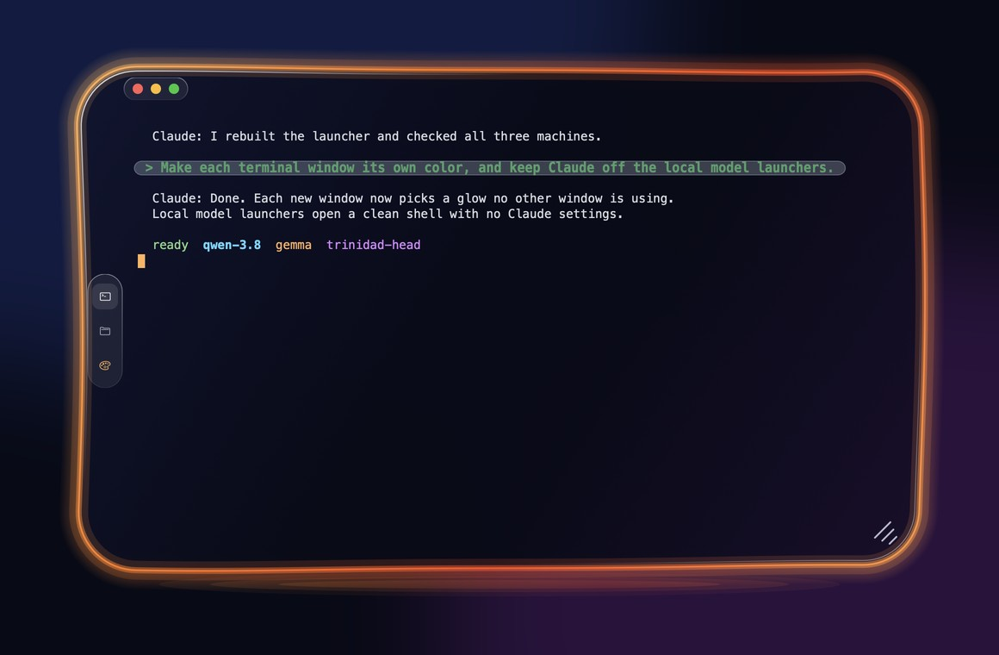
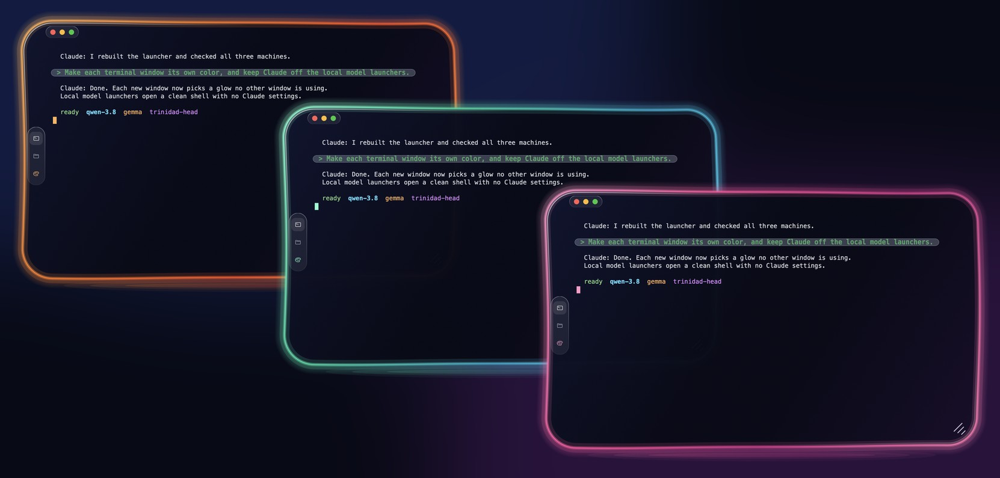
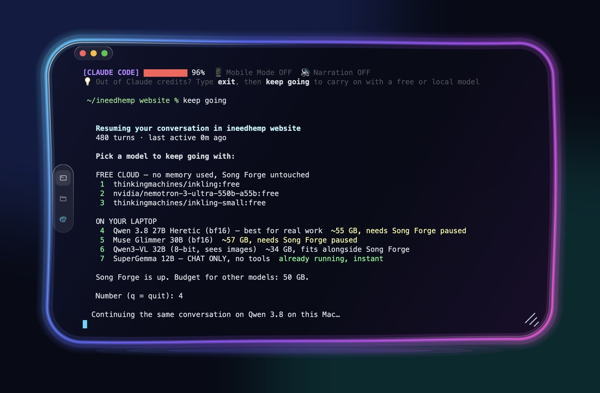

# Trinidad Head

Trinidad Head is a terminal app for **Windows and macOS**, written from scratch in Rust. Every
window is dark glass with a glowing neon rim, every open window picks a different color, and your
own prompts in a Claude Code chat sit in their own bubble so they are easy to find when you scroll
back.

[Download for Mac](https://github.com/nicedreamzapp/trinidad-head/releases/latest/download/Trinidad-Head-mac.zip){ .md-button .md-button--primary }
[Download for Windows](https://github.com/nicedreamzapp/trinidad-head/releases/latest/download/Trinidad-Head-windows.zip){ .md-button }
[Source on GitHub](https://github.com/nicedreamzapp/trinidad-head){ .md-button }

## Who it is for

- People who keep several terminals open at once and lose track of which is which. Each window
  takes one of eight glow colors that no other open window is using.
- People who spend long sessions in [Claude Code](https://www.anthropic.com/claude-code) or other
  AI command line tools. Trinidad Head is not an AI tool itself; it is the window those tools run in,
  with a few features aimed at them (see below).
- People running local models from the command line, who want each model's window to look
  different from the others.

## What it does

- **A color per window.** Eight glow themes: aurora, ember, tide, rose, ocean, gold, violet and
  lime. A new window takes the first one no other open window uses. The palette button on the side
  of the window cycles that window's color.
- **Your prompts stand out.** Cells painted in Claude Code's "your message" bar color are drawn as
  a see-through pill with bigger, bold, green text.
- **Faint text looks faint.** Text marked faint (SGR 2), such as Claude Code's ghost suggestion, is
  drawn at a third of its brightness.
- **Select and copy, even inside full-screen programs.** Drag to select, even when the program has
  taken the mouse (Claude Code's full-screen view, for example). A plain click still goes to the
  program; a drag becomes a selection. Keep dragging past the top or bottom edge and the view keeps
  scrolling.
- **Edit Claude Code's prompt like a text box.** Highlight words inside Claude Code's input box and
  press Backspace or Delete to remove them, or type or paste over them.
- **Nothing copies by itself.** Selecting does not copy. Copy with Cmd+C (Mac), Ctrl+C with a
  selection (Windows), or the right-click menu.
- **Links and files.** Cmd+click (Mac) or Ctrl+click (Windows) opens a web link. Dropping files on
  the window types their paths, which Claude Code turns into attachments.
- **Dictation and input methods** go through the Mac's own text input system.
- **A typing-delay meter** on Windows shows the median and 95th percentile time from key press to
  the frame that shows the echo, in the window title.
- **One Dock icon on the Mac**, however many windows are open.

## Made for local models too

If you run models on your own computer, Trinidad Head pairs with
[Claude Code Local](https://github.com/nicedreamzapp/claude-code-local), a separate project by the
same author. The screenshot below is from the v0.1.0 release. The "keep going" command and the model
menu in it come from that project, not from Trinidad Head; Trinidad Head is the window drawing it.

## What it is not (yet)

These limits come straight from the README and the code:

- **No Linux window.** On Linux the program prints `trinidad-head: there is no window for this OS yet`
  and exits.
- **One shell per window.** No tabs or splits.
- **No settings screen.** The one setting (the default glow) lives in a small text file. See
  [Configuration](configuration.md).
- **The Windows download is not code-signed**, so SmartScreen warns on first launch. The Mac
  download is signed with a Developer ID and notarized.

## Next steps

- [Install it](install.md) from a download or from source.
- [Quickstart](quickstart.md): open windows, run a command, copy and paste.
- [How it works](how-it-works.md): the three Rust crates and what each does.
